# Object Attribute Memory

Object Attribute Memory -**OAM**- is a memory area where the currently displayed objects are stored.

!!! warning

    The term *object*, when used in the console's context might be very far from what you know if you're familiar with OOP.

## Object

Objects are items displayed on top of the Map layer, they can be used to represent everything that has to be dynamic in a game (the player, an item, an enemy's bullet...).

### Memory representation
An **object size** in memory is `10 bytes`

An object is a basic data structure stored in memory like so *(`n` being the number of the object to store)* :

| Address | Size        | Name           | Purpose |
|---------|-------------|----------------|---------|
|`OAM_BASE_ADDRESS + n x Object size`| `16-bit`    |   `X_POS`      | The X position on screen of the object + 32 |
|`OAM_BASE_ADDRESS + n x Object size + 2`| `16-bit`    |   `Y_POS`      | The Y position on screen of the object + 32 |
|`OAM_BASE_ADDRESS + n x Object size + 4` | `16-bit`    |   `TILE INDEX`      | Index of the **top left** object tile in the [tileset](./graph_overview.md#tileset)|
|`OAM_BASE_ADDRESS + n x Object size + 6`| `16-bit`    |   `ANIM_SPRITES`      | Number of step to animate the object -if any- [TODO] : *Plus utilisé, délégué au developpeur car impose un rangement des tiles peu intuitif dans le tileset.* |
|`OAM_BASE_ADDRESS + n x Object size + 8`| `16-bit`    |   `FLAGS`      | Several 1-bit flags telling how the object's sprites will be displayed |

### Attributes

#### X_POS

The objects's `X_POS` represents the object's top-left position of the sprite X axis **plus** an offset of 32 pixels. This offset is used to make an object appear on the screen.

Here are 2 examples :

<figure markdown="span">
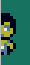
<figcaption>X_POS = 24</figcaption>
</figure>

<figure markdown="span">
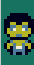
<figcaption>X_POS = 30</figcaption>
</figure>

As you can see, the sprite can appear *from outside* of the screen, otherwise it would just spawn at top left (like it was done on the NES or old systems like this)

#### Y_POS

Same as the X_POS : 

The objects's `X_POS` represents the object's top-left position of the sprite X axis **plus** an offset of 32 pixels.

#### Tile Index

This is the tileset's index of the object you want to display.

!!! note

    If this is an 8x8 object it's fine, but otherwise, know that this value represents the top-left tile of your object. Check informations about resolution flag lower in this page. 

#### Flags

The flags are switches that tells the console to display the sprites of an object a way or another. Here what they are and what they mean.

!!! note

    Naming them *flags* may be misleading as some are not individual bits, but it seemed relevent for the values to be combined as they serve the same purpose.

| Bits    | 16 15         | 14 13 12 11 10 | 9            | 8 7 6            | 5 4 3 2    | 1      | 0      |
|---------|---------------|----------------|--------------|------------------|------------|--------|--------|
| Flag    |   *unused*    | Frame duration | Transparency | Animation offset | Resolution | Y Flip | X Flip |

##### Frame duration

If the object is animated, [TODO] : *Comme le ANIM_SPRITE, pas sûr de l'utiliser*

##### Transparency

If set, the color index `0` is transparent and does not masks the Map layer 

- *Here an exemple with **Transparency** flag set (`bit 9 == 1`) on the heart object* 
- *Here an exemple with **Transparency** flag unset (`bit 9 == 0`) on the heart object* 

##### Animation offset

The next **tile index** of the object, the offset is multiplied by the **resolution**.

##### Resolution

These 4 bits tells the console the size of the object, it displays the object's `TILE_INDEX` first then displays contiguous tiles depending on the value of the resolution. 

<figure markdown="span">
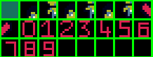
<figcaption>The tileset used in this example</figcaption>
</figure>

*Every object displayed will have it's `TILE_INDEX` set to `9` (and so, top left will be displayed as a `0` tile)*

| Resolution value | Size  | Example |
|------------------|-------|---------|
| `0bOOOO`         | 8 X 8 | 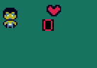 |
| `0bOOO1`         | 8 X 16 | 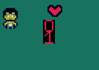 |
| `0bOO10`         | 8 X 32 | 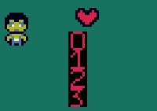 |
| `0bOO11`         | 16 X 8 | 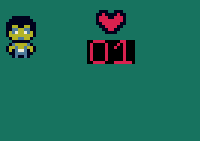 |
| `0bO100`         | 16 X 16 | 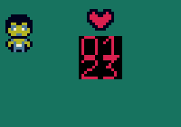 |
| `0bO101`         | 16 X 32 | 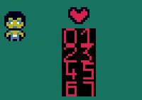 |
| `0bO110`         | 32 X 8 | 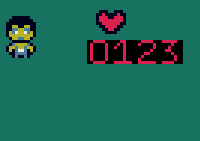 |
| `0bO111`         | 32 X 16 | 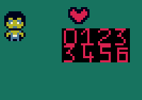 |
| `0b1000`         | 32 X 32 | 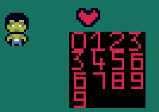 |

[TODO] : Comme vu dans la dernière image, j'ai un bug sur les objets en 32x32 (répétition du 6 et du 9)