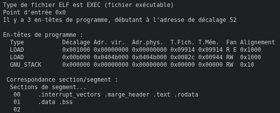

# Cartridge

The cartridge is what is going to be loaded by the console. As seen in the [Memory Map](./memory_map.md), it is composed of a ROM and RAM section.

## ROM

The ROM section is where instructions are fetched and data is encoded. Your program should not write into this memory space. At it's core, it is an  file and as such, you can use whatever Unix command works on them.

<figure markdown="span">

<figcaption>Using a readelf command on a game ROM</figcaption>
</figure>